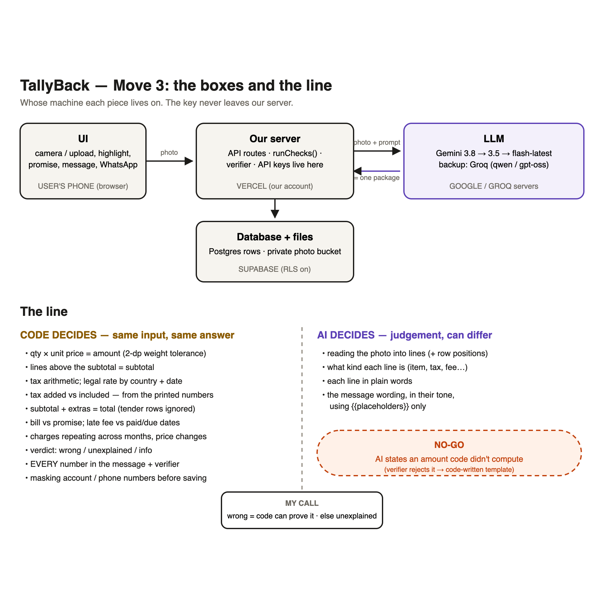
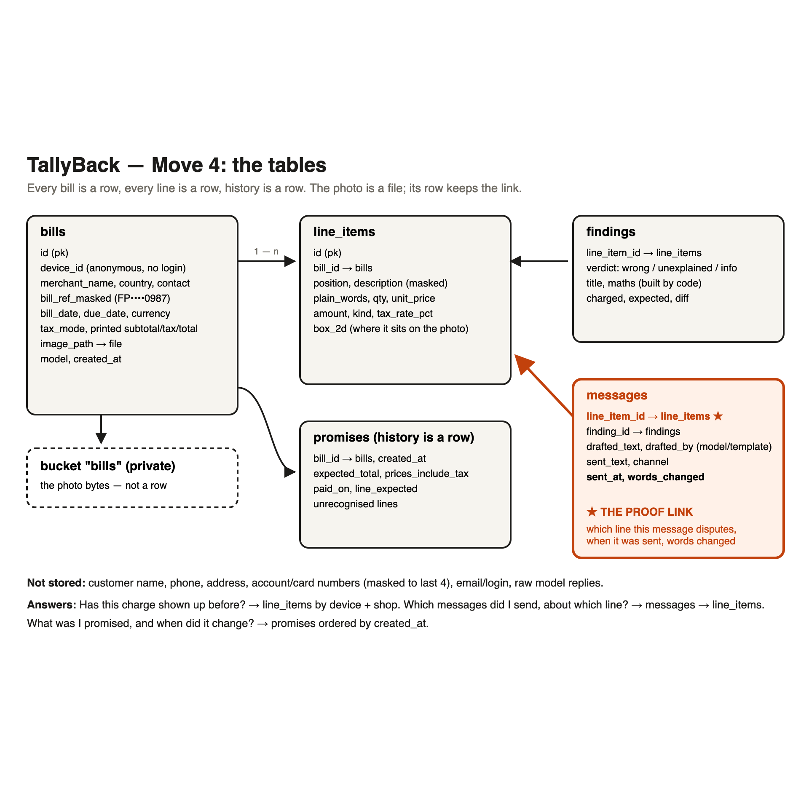

# BillShield submission: TallyBack

> Working copy of the brief's template. Lines marked **⟨TODO⟩** need something only you can do (a real session, a photo, a send). Everything else is filled from what we built and tested.

## Green-flow status (as of Sun 18 Oct, 22:20)

| Move | Deadline | Status | What's missing to be green |
|---|---|---|---|
| 1 · Do it by hand | Sun 3 PM | 🟠 **Late, partial** | A **classmate's** bill done by hand, and their send. So far: 2 people outside the cohort (Santhosh, Manish), 0 messages sent, 3 of 10 golden pairs |
| 2 · Needs first | Sun 9 PM | 🟠 **Late, drafted** | The real follow-up question from the by-hand replay (below is our best evidence, to confirm) |
| 3 · Draw the line | Sun 9 PM | 🟢 **Ready** | Optional: redraw on paper and photograph it. The brief says "draw yours on paper"; `move3-the-line.png` is a clean version |
| 4 · Lock the data | Drawn Sun 9 PM, locked Mon 9 PM | 🟢 **Done** | Schema live in Supabase, migration applied, proof link `messages.line_item_id` stored |
| 5 · Watch them use it | Tue 9 AM, Tue 9 PM | ⚪ **Not started** | Classmate (Chetan) + stranger sessions on a **public live link** |
| Live link | before Tue | 🔴 **Blocking** | `tallyback.vercel.app` serves another app; use `tallyback.tinkeryard.dev` and turn off Vercel login |

**Our bar (written before testing):** the user sends the message to the company within 24 hours with **fewer than 20 words changed**, and **every number in it was computed by code**. If every line checks out, showing that with the maths counts as a real answer.

---

```
BILLSHIELD SUBMISSION
Name / track:   Krishna Nellutla ⟨confirm⟩ / BillShield (Problem 1 of 3)
Live link:      ⟨TODO: https://tallyback.tinkeryard.dev once the domain is added and protection is off⟩
Public repo:    https://github.com/krnellutla/Tallyback
```

## MOVE 1, BY HAND

**Whose bill, what kind (masked photo attached):**
- Santhosh (outside the cohort): 2 grocery receipts, Velan Mini Super Mart, Singapore, 8 and 12 Oct 2026. Photos: `References/WhatsApp Image 2026-10-18 at 11.39.48/49.jpeg` ⟨attach masked; they show only shop details⟩
- Manish (outside the cohort): FairPrice Finest supermarket receipt + The Daily Brew café receipt, Singapore, 12 Oct 2026.
- ⟨TODO: Nagarjun's internet bill (classmate). Do the by-hand session, then add it here. This is the one that makes Move 1 count.⟩

**The line I flagged and the maths:**
- Santhosh, 12 Oct: **nothing flagged. Every line checks out.** 18 lines = S$56.95 = total paid. GST included S$4.70 = 56.95 × 9/109. The printed subtotal of S$56.94 is a 1¢ rounding difference, not an overcharge. Across both days, carrot, beans, drumstick, brinjal and bottlegourd were the same S$/kg; coriander was ~7% cheaper on 12 Oct (a price change, under 1¢ of effect).
- Manish, FairPrice: **GST 8% S$2.73 added on top** of a S$34.07 subtotal → S$36.80. Singapore retailers must show GST-inclusive shelf prices, so if the shelf said S$4.95 for milk, he should have paid **S$34.07: S$2.73 over**. The rate is also out of date (9% since 1 Jan 2024; at 9% the total would be S$37.14). Verdict: *unexplained* until Manish confirms the shelf prices. ⚠️ The receipt shows signs of being a generated sample (phone 6788 1234, barcode 1234567890123). ⟨Ask Manish whether it's real; the brief says sample bills don't count.⟩

**The message I wrote / did they send it / what they changed:**
- Santhosh: all-clear note with the maths: "Nothing to dispute. Was there a specific item you thought was off?" ⟨TODO: his reply⟩
- Manish (draft, only if the shelf price was inclusive): "receipt FP202610120987 … adds GST of S$2.73 on top … I expected to pay S$34.07, not S$36.80 … Please refund S$2.73." ⟨TODO: sent? words changed?⟩

**Golden pairs (link):** `docs/golden-pairs.csv`: 3 of 10 (GP01 Velan all-OK, GP02 FairPrice S$2.73 conditional, GP03 Daily Brew fine if the menu said "++"). Each is also an automated test in `tallyback/tests/`. ⟨TODO: 7 more across the cohort⟩

**Sit with it (which line did they care about that I didn't flag?):** ⟨TODO: from Santhosh/Manish/Nagarjun⟩

## MOVE 2, NEEDS FIRST

**Need list** (no tools named; each traced to something seen):
1. Take a photo of any bill, or upload one. *Testers sent WhatsApp photos of receipts, not PDFs, and not only utility bills.*
2. Read every line and explain it in plain words. *Receipt item names were cryptic ("KX Mooong split 500 g").*
3. Ask what they were promised; "what I expected to pay" counts. *None of the receipts carried a promise; the verdict on FairPrice depends entirely on the shelf price.*
4. Show the maths, and point at the one line on the bill. *By hand, the answer was always one line plus its working.*
5. Say "every line checks out" when it does. *Santhosh's two receipts.*
6. Write the message; let them edit, copy or send it where the company is. *Velan prints its WhatsApp number on the receipt.*
7. Remember bills, so the next one can be compared. *Same shop, 4 days apart: are the prices the same?*

**The follow-up from the replay, and the interface it picked:**
The follow-up that decided the verdict was **"Did the shelf price already include GST?"** (FairPrice), plus the brief's own example "Is 18% GST right?". Both are **one specific question about one line**, not open conversation. So the interface is **a form, not a chat**: upload → highlighted bill → a few targeted questions (expected total, "did the price include tax?", "when did you pay?", "I don't recognise this line") → one message. The answers are stored as rows, so they work as memory for that bill. ⟨Confirm with the real follow-up from the classmate session; if they asked something open-ended, add a small Q&A box.⟩

## MOVE 3, THE LINE

 ⟨or a photo of your paper drawing⟩

**Code decides:** quantity × unit price; lines above the subtotal = subtotal; tax arithmetic; the legal tax rate for the country and bill date; whether tax was added or included (from the printed numbers); subtotal + extras = total (payment rows printed after the total ignored); bill vs promise; late fee vs paid and due dates; charges repeating across months and price changes; the verdict; **every number in the message**, plus a verifier that rejects any number code didn't produce; masking before saving.

**AI decides:** reading the photo into lines and where each row sits; what kind each line is; each line in plain words; the message wording and tone, using `{{placeholders}}` only.

**My call on wrong vs unexplained, and its failure mode:**
*Wrong* only when code can prove it from the bill and what the user told us (maths, legal rate, above the promise, late fee paid on time). The message then asks for a refund. *Unexplained* when the user doesn't recognise a line or a fee repeats. The message then asks the company to explain and reverse it. Anything else is an *info* note, never a message.
**Failure mode:** we under-flag. A real overcharge stays a note until the user supplies the promise (FairPrice is "info" until they say the shelf price included GST). We chose this over false accusations. A second failure mode: if the model misreads a number, code can "prove" a wrong error. Mitigations: totals are reconciled both ways, the working is always shown so the user can spot a misread, and real-bill cases are locked in as tests (e.g. a payment row printed after the total once produced a false S$56.95 "error").

## MOVE 4, THE DATA



**What I chose not to store:** the customer's name, phone, address or email (there's no login, just an anonymous device id); account, card and phone numbers in line text and bill references, masked to the last 4 before saving; raw model replies and prompts. The bill photo is kept in a **private** bucket; its row holds only the path. RLS is on for all tables, with no public policies, so only our server can read or write.

## MOVE 5, WATCH THEM

**Classmate (Chetan): sent? words changed?** ⟨TODO Tue: bill he brings, which line, sent Y/N, words changed (the app logs this automatically: My bills → bill → status)⟩

**Stranger (Manish or Santhosh, with a bill we haven't seen): sent? words changed?** ⟨TODO Tue: they use it alone; you watch and don't help⟩

**The surprise:** where real bills broke the plan. Already found before Tuesday:
1. A card payment printed after the total ("VISA 56.95") was read as a payment against the bill, producing a false S$56.95 "error".
2. Tax rates often aren't printed ("GST Included S$4.70"), so code falls back to the legal rate.
3. The model said tax was "included" when it was added on top, so the printed numbers now decide.
4. A footer row ("GST Summary 8% 2.73") was counted as an item.
5. Item names arrive with the qty and price copied in ("4. Carrot 0.88 2.46"), which broke matching across bills.
⟨TODO: add the Tuesday surprise⟩
